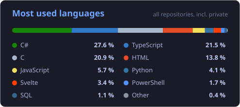

# Hi, I'm Adam 👋

---

### 🧑‍💻 About me

- 📍 17-year-old developer from the Czech Republic
- 🖥️ I build **desktop applications** in C# / .NET (WPF) and **web apps** in JavaScript & TypeScript
- 🗄️ I work with **databases and cloud backends**: PostgreSQL, Supabase, serverless functions
- ⚙️ I like automating things: scripts, automated testing and deployment
- 🚀 Currently working on a **cross-platform finance app**: C# desktop client, TypeScript & JavaScript web app and a PostgreSQL cloud backend
- 🌱 Currently leveling up in **TypeScript** and **SQL**

### 💬 Programming languages

### 🛠️ Tools & technologies

### 📊 Most used languages

### 📫 Contact

─── ⋆⋅ ♰ ⋅⋆ ───

